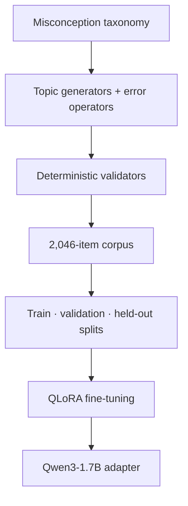
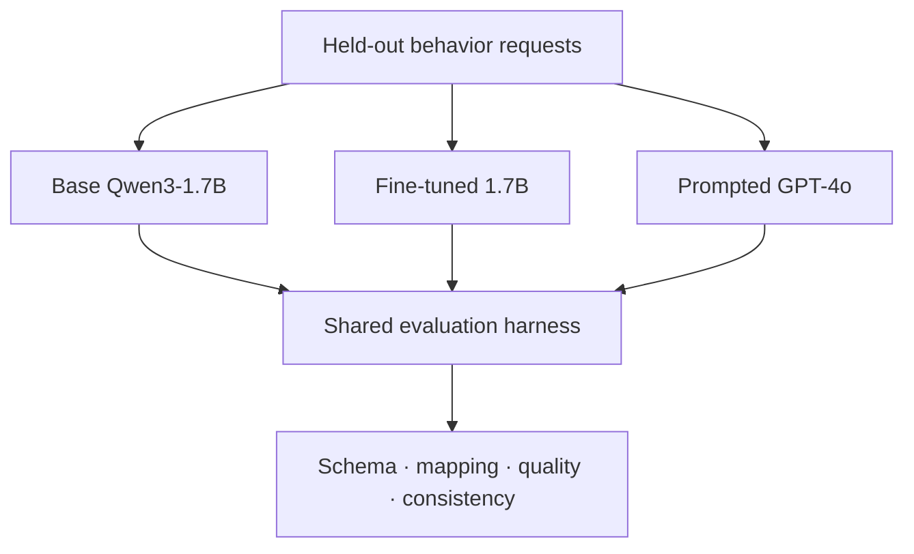

# QuestionGen

QuestionGen fine-tunes a 1.7B-parameter language model to generate AP Biology multiple-choice questions in which every wrong answer represents a named student misconception. The output is structured JSON, so an adaptive learning system can diagnose *why* an answer is wrong instead of recording only correctness.

**[Project showcase](https://gabriel-xiong.github.io/QuestionGen/)** · **[Try it in Colab](https://colab.research.google.com/github/gabriel-xiong/QuestionGen/blob/main/notebooks/try_it.ipynb)** · **[Model on Hugging Face](https://huggingface.co/gabriel-xiong/apbio-item-generator-qwen3-1.7b-lora)**

## At a glance

| | |
|---|---|
| **Problem** | Generate biology questions whose wrong answers reveal a specific student misconception—not just a plausible mistake |
| **Model** | Qwen3-1.7B adapted with QLoRA / LoRA |
| **Behavioral target** | Valid JSON, four choices, one correct answer, and one requested misconception per distractor |
| **Dataset** | 2,046 by-construction items across five AP Biology topics |
| **Evaluation** | Programmatic schema checks, objective genetics recomputation, and a human-calibrated LLM judge |
| **Core result** | Fine-tuned consistency rose from 15% to 80% fully correct on the in-distribution evaluation |
| **Stack** | Python, Transformers, PEFT, Unsloth, Gradio, Hugging Face Hub |

## Why this problem is harder than question generation

A plausible wrong answer is not automatically diagnostic. Real question banks often contain filler options that are false without corresponding to a coherent belief. In the harvested sample used during exploration, roughly half of distractors could not be mapped to the target misconception taxonomy.

QuestionGen reverses the data-generation direction: start with a misconception, apply it as an **error operator**, and produce the wrong answer a student holding that belief would choose. This makes the label part of the construction process instead of a guess added afterward.

## System design

### Training path



### Evaluation path



## Data pipeline

The corpus covers cellular respiration, enzymes, membrane transport, evolution, and genetics with an approximately even procedural/conceptual balance.

- **Conceptual topics** use curated frames that encode competing misconceptions.
- **Genetics items** use a Punnett solver, which allows the correct answer and distractor transformations to be recomputed.
- **Validators** enforce unique choices, one keyed answer, requested tag coverage, schema shape, and deduplication.
- **Human review** samples the generated corpus before an unseen split is held out.
- **The generation specification is shared** between training and evaluation so format differences do not become a hidden confound.

The model receives a topic plus three misconception IDs and learns to emit one item:

```json
{
  "stem": "How does an enzyme increase the rate of a chemical reaction?",
  "choices": {
    "A": "It lowers the activation energy required for the reaction.",
    "B": "It increases the activation-energy barrier.",
    "C": "It binds and converts any available molecule.",
    "D": "It shifts equilibrium toward the products."
  },
  "correct": "A",
  "distractor_tags": {
    "B": {"misconception_id": "enz_raise_activation_energy"},
    "C": {"misconception_id": "enz_specificity_any_substrate"},
    "D": {"misconception_id": "enz_change_equilibrium"}
  }
}
```

## Evaluation before training

The behavior specification and scoring harness were written before the fine-tuning run. Each output receives a 0–2 score on:

1. **Spec adherence** — one valid JSON object, four distinct choices, one correct answer, and every wrong option tagged.
2. **Distractor mapping** — each wrong answer actually expresses its assigned misconception.
3. **Task quality** — the biology is correct, the keyed answer is right, and distractors remain plausible.
4. **Consistency** — repeated prompts produce fully compliant items reliably.

Structural checks are deterministic. Genetics content is scored through objective recomputation. Conceptual content uses an LLM judge only after judge calibration: on a set with 15 deliberately injected labeling errors, GPT-4o mini missed all 15 while GPT-4o matched the human labels on all 15. The stronger judge was therefore used for the reported conceptual evaluation.

This does not make the judge ground truth; it makes the choice measurable and exposes where human review is still required.

## Results

### In-distribution evaluation (0–2 unless noted)

| Dimension | Base Qwen3-1.7B | Fine-tuned 1.7B | Prompted GPT-4o |
|---|---:|---:|---:|
| Spec adherence | 1.80 | **2.00** | **2.00** |
| Distractor mapping | 1.05 | **1.80** | 1.90 |
| Task quality | 1.71 | **2.00** | 1.95 |
| Fully correct rate | 15% | **80%** | 90% |

For objective genetics cases, the base model scored 0/40 and the fine-tuned model scored 40/40.

### Generalization boundary

| Distractor mapping | Base 1.7B | Fine-tuned 1.7B | Prompted GPT-4o |
|---|---:|---:|---:|
| In distribution | 1.05 | **1.80** | 1.90 |
| Held-out topic | 0.70 | **1.35** | 1.75 |

The specialist approaches the frontier model on its trained niche, but the frontier model remains stronger outside that coverage. An earlier three-topic dataset caused negative transfer on the held-out topic; adding topic diversity turned the fine-tuned model's out-of-distribution delta positive. The useful result is therefore not "small models replace frontier models," but that a narrow behavior can be taught efficiently when the data construction matches the behavior—and that its boundary can be measured.

## Example failure corrected by fine-tuning

On a photosynthesis request with three required misconceptions, the base model produced a superficially valid question but left two distractors untagged. The fine-tuned model produced all four choices, keyed one correct answer, and mapped each wrong answer to one of the requested misconception IDs.

That distinction is the product requirement: a question can look reasonable to a reader while still being unusable for diagnosis.

## Reproduce the workflow

The full GPU workflow is in [`notebooks/run_all_pipeline.ipynb`](notebooks/run_all_pipeline.ipynb). It builds the corpus, prepares supervised examples, trains the adapter, and runs the held-out evaluation.

For local inspection:

```bash
git clone https://github.com/gabriel-xiong/QuestionGen.git
cd QuestionGen
python -m venv .venv
source .venv/bin/activate
pip install -r requirements.txt

python scripts/validate_corpus.py --help
python scripts/eval_generation.py --help
```

On Windows PowerShell, activate with `.\.venv\Scripts\Activate.ps1`.

API keys are read from environment variables or a git-ignored `.local/.env`. Notebook flows use secure login prompts; secrets should not be pasted into committed cells.

## Repository map

```text
scripts/
  conceptual_engine.py        shared frame-based conceptual generator
  gen_*.py                    topic generators and misconception operators
  build_dataset.py            corpus assembly and split construction
  validate_corpus.py          independent validation and review workflow
  gen_spec.py                 shared generation contract
  train_gen_sft.py            QLoRA fine-tuning
  eval_generation.py          base-vs-tuned behavior evaluation
  score_rubric.py             deterministic and rubric scoring
  judge.py                    calibrated conceptual-content judge
  app.py                      Gradio inference application
data/
  gen_*.jsonl                 constructed dataset and SFT splits
  eval_scenarios*.jsonl       in-distribution and held-out requests
docs/
  behavior_spec.md            falsifiable target behavior
  brainlift_generator.md      full methodology, analysis, and limitations
  summary.md                  one-page technical summary
notebooks/
  run_all_pipeline.ipynb      end-to-end training and evaluation
  try_it.ipynb                lightweight model demo
```

## Current limitations

- The dataset covers five biology topics, not the complete AP Biology curriculum.
- By-construction data guarantees intended labels, but templating can narrow linguistic diversity.
- Conceptual mapping metrics depend on an LLM judge and should be periodically audited by subject-matter experts.
- The reported sample is adequate for iteration, not a claim of classroom efficacy.
- No student-learning or psychometric study has yet shown that misconception-tagged generation improves outcomes.
- The adapter still requires the Qwen3-1.7B base model and GPU-backed training or practical inference infrastructure.

## Project context

This repository previously explored algebra error classification; the retained legacy documents show the earlier direction. The current project is centered on AP Biology item generation, with the behavior specification, dataset pipeline, evaluation harness, adapter, and showcase aligned around that goal.
